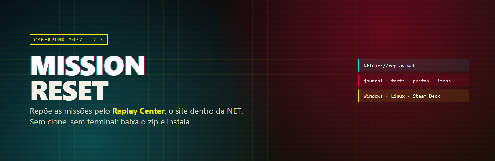
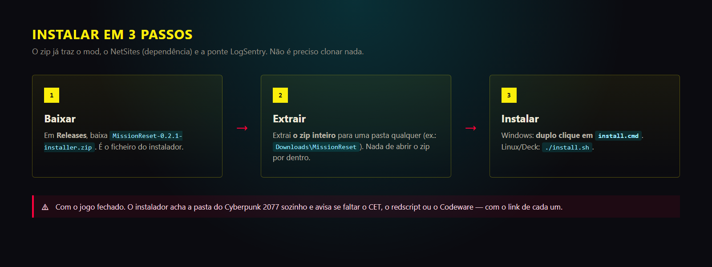
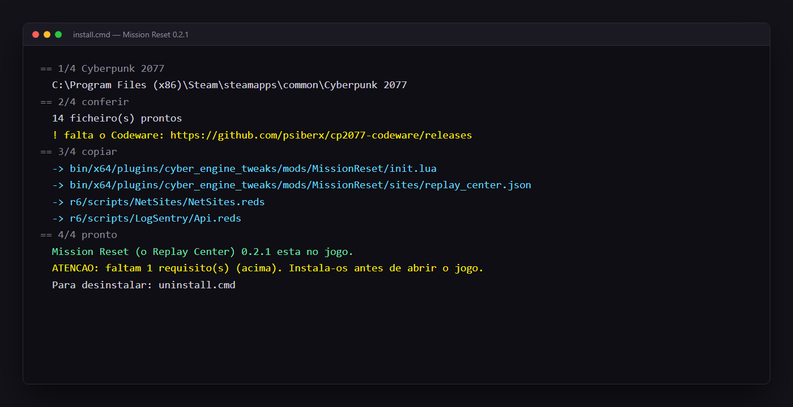

  

  # Mission Reset — Cyberpunk 2077

  **Repõe as missões do Cyberpunk 2077 pelo Replay Center, o site dentro da NET.**
  Baixa o zip, instala, joga. Sem clone, sem terminal, sem compilar nada.

  
  
  
   
  
  
  

---

## ⤓ Baixar

**[➜ MissionReset-0.2.1-installer.zip](https://github.com/frederico-kluser/cyberpunk2077-mods-public/releases/latest)**

O zip **já traz tudo o que o mod precisa para funcionar**: o Mission Reset, o NetSites (a dependência que desenha o site) e a ponte LogSentry. Não há mais nada para descarregar aqui.

---

## Instalar — 3 passos

1. **Baixa** o `MissionReset-0.2.1-installer.zip` em [Releases](https://github.com/frederico-kluser/cyberpunk2077-mods-public/releases/latest).
2. **Extrai o zip inteiro** para uma pasta qualquer (ex.: `Downloads\MissionReset`). Não abras o zip por dentro.
3. **Fecha o jogo** e faz **duplo clique em `install.cmd`** (Windows) ou corre `./install.sh` (Linux / Steam Deck).

É isto. O instalador encontra a pasta do Cyberpunk 2077 sozinho, copia os 14 ficheiros e diz o que ficou.

  

> O instalador **avisa** (sem impedir) se faltar um requisito: o Cyber Engine Tweaks, o redscript ou o Codeware, sempre com o link. Se aparecer «falta o Codeware», instala-o — é o que dá o scroll nativo na NET.

---

## Como usar

1. Entra no jogo, abre um **computador** e vai à NET.
2. Na página inicial, carrega no azulejo **NetSites** → **Replay Center** (ou escreve `NETdir://replay.web`).
3. Escolhe a categoria, lê a página de confirmação e escreve **CONFIRMAR**.
4. **Guarda e carrega o jogo** e volta ao local.

| Categoria | O que repõe | Quantas (2.5) |
| --- | --- | --- |
| `ncpd_police` | os «Reported Crime» do scanner NCPD | 28 |
| `assaults` | os POIs «Assault in Progress» (gangue e loot) | 116 |
| `gangs` | as «Suspected Organized Crime Activity» | 9 |
| `side` | as missões secundárias do journal | 134 |

Uma categoria só fica disponível **quando todas as missões dela estão concluídas** — e depois de repores, ela bloqueia até voltares a terminar tudo. O reset tira do inventário **só os itens daquela missão**: eddies, roupa icónica, consumíveis e carros ficam onde estão.

---

## Requisitos

| Requisito | Versão | Onde |
| --- | --- | --- |
| Cyberpunk 2077 (PC) | **2.5** (`3.0.88.46235`) | Steam, GOG ou Epic |
| Cyber Engine Tweaks (CET) | ≥ 1.38.0 | [GitHub](https://github.com/maximegmd/CyberEngineTweaks/releases) · [Nexus](https://www.nexusmods.com/cyberpunk2077/mods/107) |
| redscript | ≥ 0.5.32 | [GitHub](https://github.com/jac3km4/redscript/releases) · [Nexus](https://www.nexusmods.com/cyberpunk2077/mods/1511) |
| Codeware | 1.21.1 (recomendado) | [GitHub](https://github.com/psiberx/cp2077-codeware/releases) |
| NetSites + LogSentry | — | **vêm dentro do zip** |

> Plugins de antes do 2.5 fecham o jogo no arranque: usa as versões da tabela ou mais novas.

---

## Desinstalar

- **Windows:** duplo clique em `uninstall.cmd` (na pasta do zip).
- **Linux / Steam Deck:** `./uninstall.sh`.

Tira **só o mod** e repõe o que ele tinha substituído; o NetSites e a LogSentry ficam (outros mods podem usá-los). Para levar tudo: `uninstall.cmd -All` / `./uninstall.sh --all`.

---

## Problemas comuns

| Aconteceu | O que fazer |
| --- | --- |
| «não encontrei o Cyberpunk 2077» | `install.cmd "D:\Games\Cyberpunk 2077"` (a pasta com o `Cyberpunk2077.exe`) |
| «o jogo está aberto» | fecha o jogo e repete |
| O jogo fecha ao abrir | um requisito está velho: atualiza CET, redscript e Red4ext |
| O azulejo NetSites não aparece | vê `bin\x64\plugins\cyber_engine_tweaks\scripting.log` |
| Repus a missão e não voltou | **guarda e carrega** o jogo; cenas e recompensas de um só uso podem não voltar (o motor de quest é one-shot) |
| Perdi o save | faz sempre um save de backup antes de repor facts de missão |

---

## English (short)

**Mission Reset** puts Cyberpunk 2077 missions back, from the **Replay Center** site inside the game's NET browser.

1. Download `MissionReset-0.2.1-installer.zip` from [Releases](https://github.com/frederico-kluser/cyberpunk2077-mods-public/releases/latest).
2. Extract the whole zip and **double-click `install.cmd`** (Windows) or run `./install.sh` (Linux/Steam Deck), with the game closed.
3. In game: NET → **NetSites** tile → **Replay Center** (`NETdir://replay.web`), pick a category, confirm, then save and load.

Requires Cyberpunk 2077 2.5, Cyber Engine Tweaks ≥ 1.38 and redscript ≥ 0.5.32 (Codeware recommended). NetSites and LogSentry are inside the zip. Uninstall with `uninstall.cmd` / `./uninstall.sh`.

---

## Por dentro

O mod é um sistema Lua no CET (o motor do reset) mais uma tabela de missões gerada dos ficheiros do próprio jogo, com o site desenhado pelo **NetSites** e cada passo provado no jogo pela ponte **LogSentry**. Este repositório é o sítio do jogador: instruções, imagens e os instaladores nas Releases.

- 📝 Post com os detalhes: [Mission Reset: reponha missões no Cyberpunk 2077](https://frederico-kluser.com/pt-br/blog/mission-reset-repor-missoes-cyberpunk-2077/)
- 🐞 Encontraste um problema? [Abre uma issue](https://github.com/frederico-kluser/cyberpunk2077-mods-public/issues)

## Créditos e licença

- **Código do instalador e deste repositório:** MIT — ver [LICENSE](LICENSE).
- **Cyberpunk 2077**, Night City, a NET e todos os nomes do universo pertencem à **CD PROJEKT RED**. Este projeto não é afiliado nem patrocinado pela CDPR e **não distribui ficheiros do jogo**.
- O mod referencia conteúdo do próprio jogo (missões, sites, ícones): não o copia.
